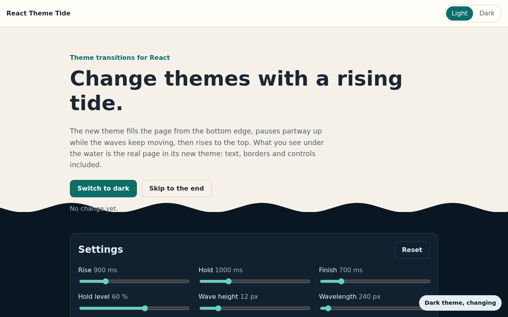
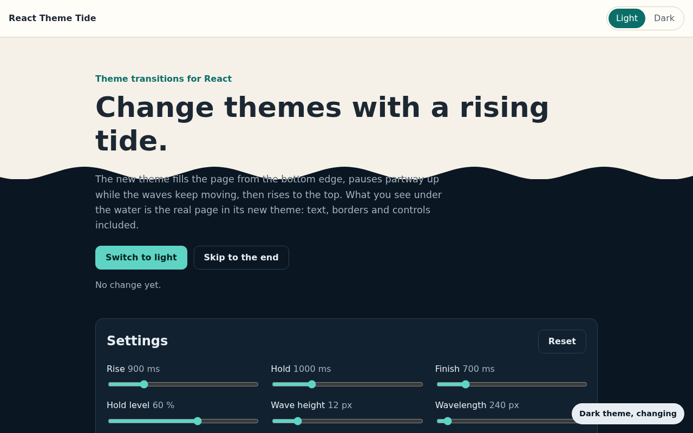
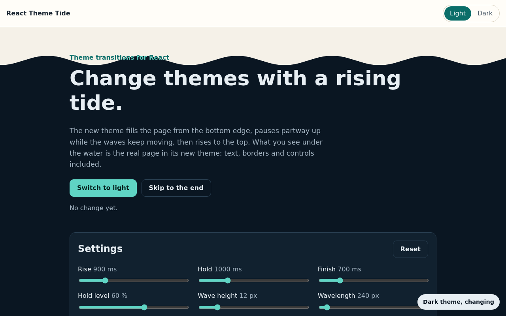
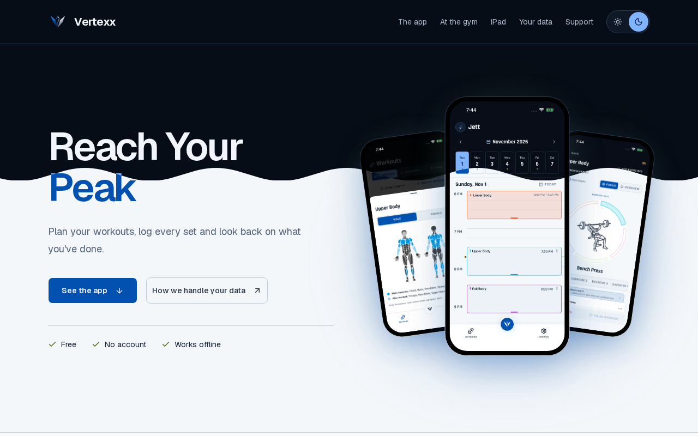
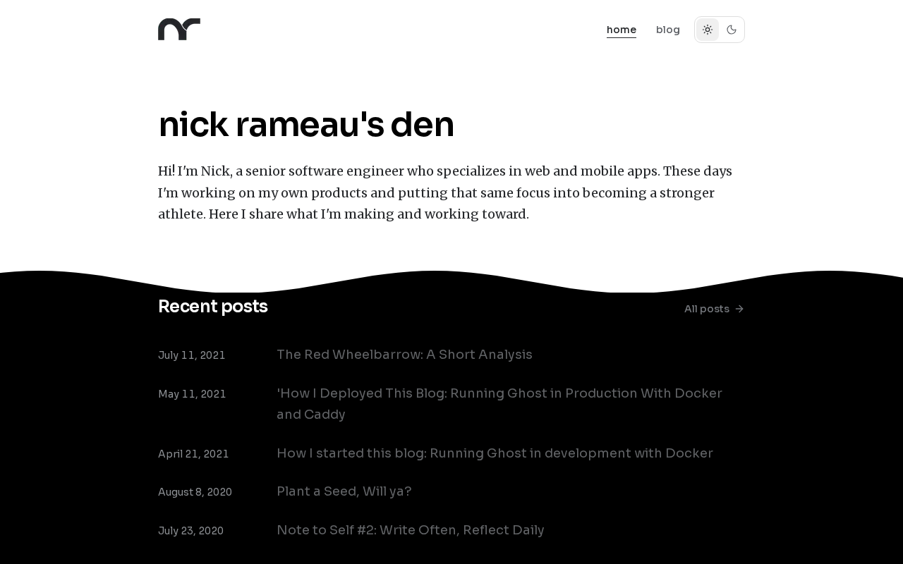
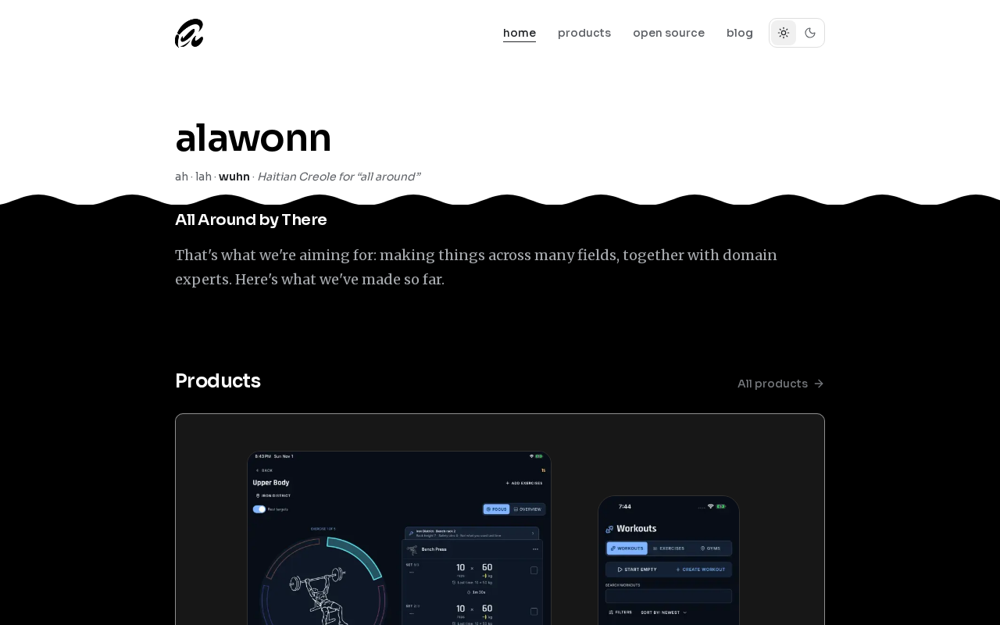
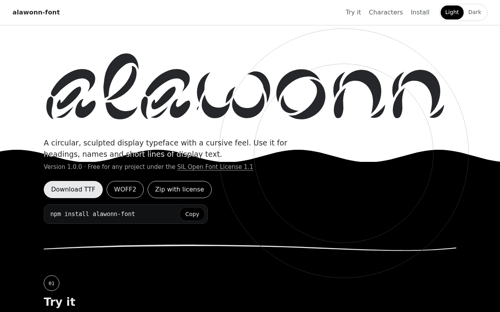

# React Theme Tide

Switch your site between light and dark with a wave of water. The new theme rises from the bottom of the screen, pauses for a second with the waves still moving, then fills the page.

<p>
  <a href="https://github.com/alawonn/react-theme-tide/blob/main/docs/images/tide-1-rise.png"></a>
  <a href="https://github.com/alawonn/react-theme-tide/blob/main/docs/images/tide-2-pause.png"></a>
  <a href="https://github.com/alawonn/react-theme-tide/blob/main/docs/images/tide-3-fill.png"></a>
</p>

**[Try the demo](https://alawonn.github.io/react-theme-tide/)**

You keep your own theme code. React Theme Tide only animates the change.

## Install

```bash
npm install react-theme-tide
```

```bash
pnpm add react-theme-tide
```

```bash
yarn add react-theme-tide
```

```bash
bun add react-theme-tide
```

```bash
deno add npm:react-theme-tide
```

You need React 18 or newer. There's no CSS to import.

## Use it

Wrap the code that changes your theme in `run`:

```tsx
"use client";
import { useThemeTide } from "react-theme-tide";

export function ThemeToggle() {
  const tide = useThemeTide();
  return (
    <button
      type="button"
      onClick={() => tide.run(() => document.documentElement.classList.toggle("dark"))}
    >
      Switch theme
    </button>
  );
}
```

Already have a function that sets and saves the theme? Pass it in as it is:

```tsx
tide.run(() => setTheme("dark"));
```

If your theme lives in React state, wrap the update in `flushSync` so the page changes before the water starts:

```tsx
import { flushSync } from "react-dom";

tide.run(() => flushSync(() => setTheme("dark")));
```

It works in Next.js too. Use the hook in a Client Component.

Changed your mind mid-tide? Add `data-theme-tide-reverse` to the button that switches back, and pressing it drains the water. [Here's how](https://github.com/alawonn/react-theme-tide/blob/main/docs/usage.md#going-back-mid-tide).

People who prefer reduced motion get an instant change. So do browsers without View Transitions.

## Sites using it

| Mid-tide | Site |
| --- | --- |
| <a href="https://vertexx.fit"></a> | [Vertexx](https://vertexx.fit) |
| <a href="https://meau.me"></a> | [meau.me](https://meau.me) |
| <a href="https://alawonn.com"></a> | [alawonn.com](https://alawonn.com) |
| <a href="https://alawonn.github.io/alawonn-font/"></a> | [Alawonn Font](https://alawonn.github.io/alawonn-font/) |

Using it on your site? [Open an issue](https://github.com/alawonn/react-theme-tide/issues/new?title=Add%20my%20site%20to%20the%20README&body=Site%20name%3A%0ASite%20URL%3A%0A) with the name and link, or send a pull request that adds it to this table.

## More

- [Usage and options](https://github.com/alawonn/react-theme-tide/blob/main/docs/usage.md): timing, waves, the API and Next.js setup.
- [How it works](https://github.com/alawonn/react-theme-tide/blob/main/docs/how-it-works.md): what happens on screen, edge cases and tested browsers.
- [Contributing](https://github.com/alawonn/react-theme-tide/blob/main/CONTRIBUTING.md)

## License

MIT
